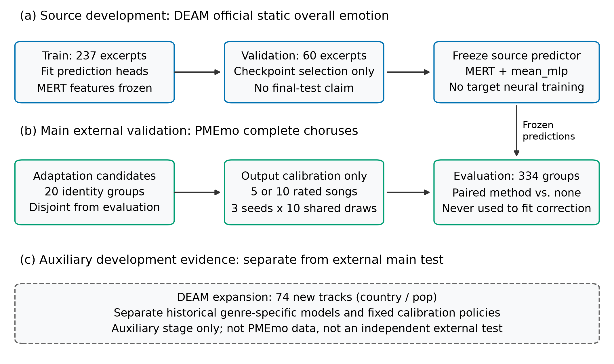
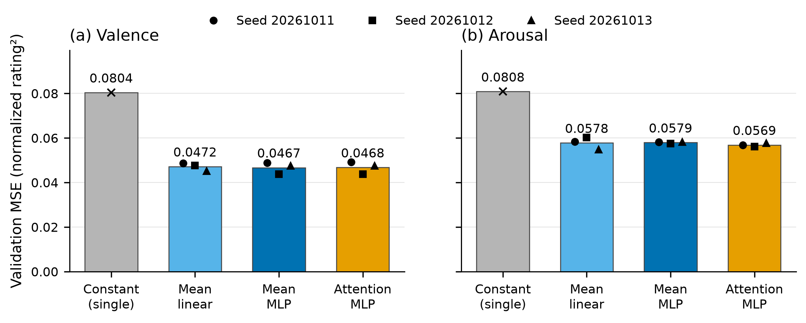
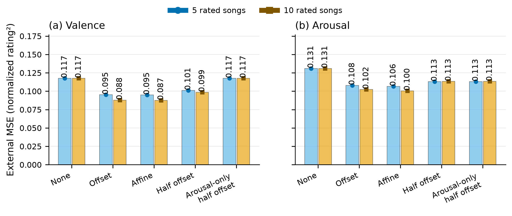
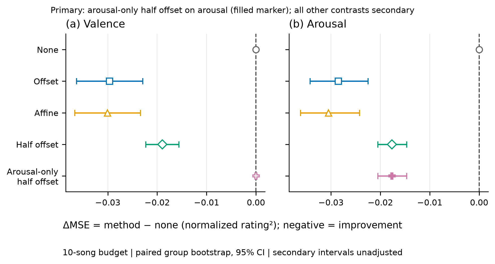
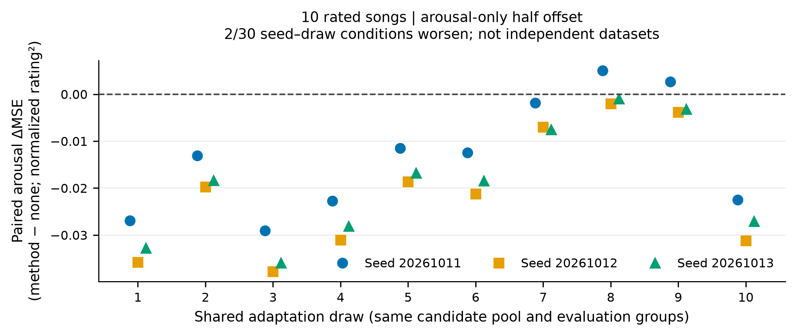
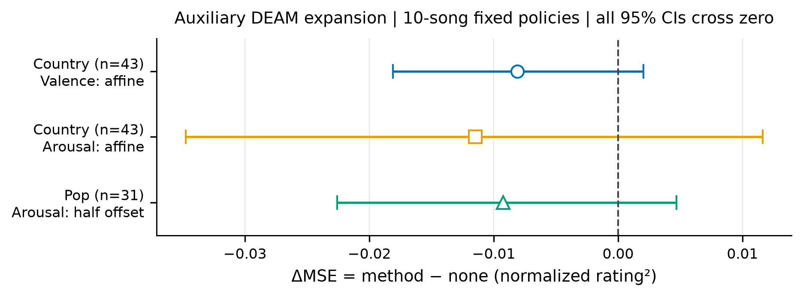

# Low-Label Output Calibration for Cross-Dataset Music Emotion Regression: A Frozen-Representation Empirical Study

## Abstract

Static music emotion regression predicts the overall valence and arousal of an audio excerpt. A predictor trained on one annotated music collection may require adjustment when applied to another collection, even when both datasets use the same emotion dimensions. We investigate whether a small number of target-domain ratings can improve such predictions without retraining the audio representation or the source prediction head. The study uses frozen MERT-v1-95M representations and lightweight regression heads developed on 237 DEAM training excerpts and 60 validation excerpts. External evaluation uses complete PMEmo2019 choruses, with conservative cross-dataset identity screening and one fixed representative per risk group. Twenty groups supply adaptation candidates and 334 disjoint groups supply evaluation excerpts. Five fixed output rules are compared under nested five- and ten-excerpt rating budgets, three source-model seeds and ten shared adaptation draws. In the prespecified primary comparison, ten-excerpt arousal-only half-offset correction reduces mean arousal squared error from 0.130907 to 0.113241, a 13.50% relative reduction. The paired error change is −0.017667, with a conditional evaluation-group bootstrap 95% interval of [−0.020519, −0.014643]. Mean absolute error decreases from 0.307113 to 0.283285 and concordance increases from 0.334115 to 0.368472, while valence predictions remain unchanged. All three seed-wise means improve; the correction benefits 28 of 30 shared seed–draw conditions, with two showing higher error. Secondary ten-rating affine comparisons reduce mean valence and arousal MSE by 25.60% and 23.30%, respectively. These findings support low-label output calibration as a practical intervention for the tested cross-dataset setting: limited target supervision improves output agreement while the pretrained representation and source predictor remain fixed. Paired group evaluation quantifies the average benefit conditional on the selected models and adaptation candidates.

**Keywords:** music emotion recognition; valence–arousal regression; cross-dataset evaluation; few-label adaptation; output calibration; frozen music representations.

## 1. Introduction

Music emotion recognition includes both prediction of an overall rating for an excerpt and estimation of its variation over time [1,2]. These settings require different targets and different evaluation units. DEAM provides separately collected static and dynamic annotations [3], while PMEmo supplies chorus excerpts with overall and time-varying annotations [4]. In this paper, the prediction target is the dataset's mean overall valence–arousal rating for the supplied excerpt. A static score is not obtained by averaging a dynamic trajectory, and a mean rating is not a direct measurement of every individual listener's experience. This distinction is necessary when transferring a predictor between datasets with different audio excerpts and annotation procedures.

Cross-dataset emotion prediction raises an additional practical issue: a source predictor can retain useful relationships with target ratings while its output location or scale is mismatched to the new collection. Ching and Widmer studied distribution gaps in dimensional music emotion recognition and investigated representation design and diversified training data [5]. Linear regression-based adaptation has been studied for personalized music emotion recognition [6]. Building on these research directions, we investigate low-label dataset-level adaptation: how much can five or ten target-excerpt ratings improve a fixed predictor through output calibration? An answer requires comparison against the unchanged predictor, separation of adaptation and evaluation items, and attention to the variability of the chosen rated excerpts.

Frozen pretrained music representations make this question experimentally tractable. MERT evaluates representations using lightweight downstream prediction with a frozen backbone [7]. We adopt that arrangement and distinguish source-head learning from target-output correction. The source head is fitted with DEAM labels; only a few scalar correction parameters are fitted with PMEmo labels. A five- or ten-excerpt target budget therefore refers to adaptation supervision, not to training an audio neural network from five or ten recordings. This separation isolates the contribution of target supervision and enables a controlled comparison of correction strength, output scale and axis-specific adaptation.

A useful calibration evaluation must measure both prediction agreement and sensitivity to the selected rated excerpts. We combine conservative metadata and exact-audio identity groups with fixed data roles and paired evaluation on held-out group representatives. Complementary error and concordance metrics capture changes in output agreement, while shared support draws allow comparison of correction rules under the same supervision. The primary contrast was fixed before PMEmo model evaluation, and complete secondary comparisons are retained. Uncertainty is estimated at the evaluation-group level, accounting for the reuse of evaluation groups across seed–draw conditions.

The main experiment evaluates DEAM-to-PMEmo static rating transfer. A source mean-pooled multilayer perceptron is retained for all three fixed training seeds. After screening the PMEmo release, twenty group representatives form an adaptation candidate pool and 334 other representatives form the evaluation set. We compare no correction, offset correction, identity-regularized affine correction, half-offset correction and arousal-only half-offset correction. The last rule, with ten rated excerpts, defines the primary arousal mean squared error comparison. Related DEAM genre-development and expansion results are reported in the appendices to distinguish exploratory method development from the main external result.

The paper makes three contributions. First, it establishes a reproducible evaluation protocol for low-label cross-dataset music emotion calibration, integrating frozen representations, aligned static targets and group-separated adaptation and evaluation. Second, it demonstrates an average arousal MSE reduction of 13.50% in the prespecified ten-rating DEAM-to-PMEmo comparison, supported by paired evaluation across 334 held-out group representatives. Third, it characterizes the effects of rating budget, correction rule and support selection through complete predefined comparisons, complementary agreement metrics and independent numerical verification. Together, these contributions provide evidence for using limited target supervision to improve the agreement of existing music emotion predictors.

## 2. Related work

### 2.1. Static ratings and cross-dataset music emotion recognition

The DEAM benchmark explicitly distinguishes overall emotion ratings from temporal annotations [3]. Surveys discuss static and dynamic prediction, subjective labels and heterogeneous dataset construction [1,2]. The PMEmo paper introduces an emotion-annotated music dataset with accompanying electrodermal activity signals [4]; its author-maintained documentation describes manually selected chorus excerpts and the updated 2019 release. We use only its audio and static mean ratings. No physiological input or listener-specific prediction is included.

Dimensional cross-dataset evaluation is directly relevant to our study. Ching and Widmer examine static emotion prediction across multiple music datasets [5]. Their representation and training-data approach addresses a different intervention from our fixed-predictor output correction. Cross-dataset recognition has also been investigated through semantic alignment of categorical labels using MERT features and language-model embeddings [8]. That categorical setting is not an exact comparator for continuous valence–arousal regression. We accordingly avoid attributing our results to categorical label alignment or comparing incompatible metrics across these tasks.

### 2.2. Frozen representations and supervised output adaptation

MERT is a self-supervised acoustic music representation model whose probing protocol freezes the pretrained backbone and fits a lightweight downstream predictor [7]. We use this representation-probing design to separate source prediction from target-output adaptation. Linear, mean-pooled nonlinear and attention-pooled nonlinear heads establish source-development baselines, while the frozen external mean-MLP provides a common reference for all calibration comparisons.

Chen et al. studied linear regression-based adaptation for personalized music emotion prediction [6]. Our setting concerns dataset-level mean ratings and a fixed five- or ten-excerpt supervision budget, rather than adaptation to a particular listener. We compare explicitly defined output rules using the same frozen predictor, support draws and evaluation groups. Classical ridge regression provides statistical context for regularization [11]; the identity-centered objective used in this study is specified in Section 3.4.

### 2.3. Output agreement and adaptation evaluation

We use *output calibration* to mean supervised correction of a regression prediction's location or scale. This is distinct from estimating calibrated predictive probabilities or uncertainty in individual ratings. Watcharasupat et al. distinguish prediction of mean music emotion ratings from prediction of inter-rater variability [9]. Our group-bootstrap intervals quantify uncertainty in an average paired error contrast under fixed adaptation settings; they do not estimate listener disagreement.

The negative-transfer literature motivates explicit evaluation against a reference predictor [10]. Here, the unchanged source predictor provides a paired reference for measuring the effect of target-output calibration. We record *calibration harm* when correction increases evaluation MSE for a specified seed and support draw. This operational measure concerns the correction itself; formal source-assisted-versus-target-only comparisons address a different question.

## 3. Prediction and output-correction methods

### 3.1. Task and rating scales

For an audio excerpt $x_i$, the target is a two-dimensional overall score $\mathbf y_i=(y_{i,V},y_{i,A})$, where $V$ denotes valence and $A$ denotes arousal. Targets are placed on a fixed $[-1,1]$ numerical scale:

$$
 y^{\mathrm{DEAM}}_{i,k}=\frac{r^{\mathrm{DEAM}}_{i,k}-5}{4},
 \qquad
 y^{\mathrm{PMEmo}}_{i,k}=2r^{\mathrm{PMEmo}}_{i,k}-1,
 \quad k\in\{V,A\}. \tag{1}
$$

The DEAM source ratings use the official static excerpt scores on the 1–9 scale. PMEmo static mean scores are checked to lie within [0,1] before the fixed mapping is applied. Neither transformation is fitted to evaluation-label extrema or moments. Equal numerical ranges do not establish identical annotation semantics.

### 3.2. Frozen audio features and source predictors

Audio is converted to mono and resampled to 24 kHz. MERT-v1-95M is frozen at revision `12af15fef9d0ac838c3f475bfbbf26d2060dd4f5`. The final four hidden layers are averaged; ten-second windows with five-second spacing provide overlapping representations, which are aggregated into one-second bins. Denote the resulting 768-dimensional sequence by $\mathbf h_{i,t}$, for $t=1,\ldots,T_i$. The mean-pooled representation is

$$
 \mathbf z_i=\frac{1}{T_i}\sum_{t=1}^{T_i}\mathbf h_{i,t}. \tag{2}
$$

The mean-linear head maps $\mathbf z_i$ directly to two outputs. The mean-MLP head uses a 32-unit hidden layer:

$$
 \hat{\mathbf y}_i=f_{\theta}(x_i)
 =\mathbf W_2\mathrm{ReLU}(\mathbf W_1\mathbf z_i+\mathbf b_1)+\mathbf b_2. \tag{3}
$$

For the source attention comparison, a scalar linear score supplies softmax weights over $\mathbf h_{i,t}$, followed by the same 32-unit head. The respective trainable parameter counts are 1,538, 24,674 and 25,443. Attention therefore adds 769 parameters and is not an exactly parameter-matched comparison. A training-mean constant is included as a source reference. The external experiment fixes the mean-MLP architecture and all three source checkpoints rather than selecting an architecture using PMEmo scores.

DEAM source features cover the full 45-second excerpt with 45 bins. PMEmo features use the complete supplied chorus, with no fixed 45-second truncation. The existing feature function includes bin centers at 0.5, 1.5, … seconds up to the actual duration, so $T_i=\lfloor D_i-0.5\rfloor+1$. A tail shorter than half a second adds no separate bin; a longer tail can contribute a partial final bin. Returned bins receive equal weights in Equation (2). This is an explicitly fixed temporal quantization rule, not exact duration-weighted averaging over all original frames.

### 3.3. Offset and half-offset correction

Let $\mathcal S_b$ be a rated target support set of size $b\in\{5,10\}$, disjoint from the evaluation set. For a frozen source prediction $p_{i,k}=f_{\theta}(x_i)_k$, the support residual mean is

$$
 \hat\mu_{b,k}=\frac{1}{b}\sum_{i\in\mathcal S_b}(y_{i,k}-p_{i,k}). \tag{4}
$$

No correction returns $p_{i,k}$. Offset correction returns $p_{i,k}+\hat\mu_{b,k}$, and half-offset returns $p_{i,k}+\tfrac12\hat\mu_{b,k}$. The axis-specific primary rule is

$$
 q_{i,V}=p_{i,V},\qquad
 q_{i,A}=p_{i,A}+\frac12\hat\mu_{b,A}. \tag{5}
$$

Thus the primary intervention estimates one scalar from the target ratings and retains the valence prediction exactly. The half strength is fixed; it is not searched over using target evaluation labels. Ratings for both axes are available in the support data, but Equation (5) uses only the arousal component. None of the output rules clips predictions to the nominal target range.

### 3.4. Identity-regularized affine correction

The affine comparator fits each axis separately. With source predictions $p_i$ and support targets $y_i$ for one axis, its objective is

$$
 (\hat a,\hat c)=\arg\min_{a,c}
 \left\{\sum_{i\in\mathcal S_b}(y_i-a p_i-c)^2+\lambda(a-1)^2\right\},
 \qquad \lambda=1. \tag{6}
$$

The intercept is unpenalized; the slope is regularized toward the identity slope. Eliminating $c$ gives

$$
 \hat a=
 \frac{\sum_{i\in\mathcal S_b}(p_i-\bar p)(y_i-\bar y)+\lambda}
      {\sum_{i\in\mathcal S_b}(p_i-\bar p)^2+\lambda},
 \qquad
 \hat c=\bar y-\hat a\bar p,
 \qquad q_i=\hat a p_i+\hat c. \tag{7}
$$

Equation (6) uses a summed squared-error loss. Replacing the sum by an average while retaining $\lambda=1$ would change the effective regularization, so the convention is part of the protocol. For two emotion axes the rule fits four scalars while keeping the source head fixed. Equation (7) gives the closed-form solution and makes the adaptation parameters directly reproducible.

### 3.5. An exact error identity for interpreting offset changes

For an evaluation set $\mathcal E$, define residuals $e_i=y_i-p_i$ and their mean $\bar e_{\mathcal E}$. A fitted offset of strength $\alpha$ produces the exact empirical identity

$$
 \Delta\mathrm{MSE}
 =\frac{1}{|\mathcal E|}\sum_{i\in\mathcal E}
 \left[(e_i-\alpha\hat\mu_b)^2-e_i^2\right]
 =\alpha^2\hat\mu_b^2-2\alpha\hat\mu_b\bar e_{\mathcal E}. \tag{8}
$$

This follows by expanding the square. It shows why a support-derived offset can either reduce or increase evaluation error depending on its magnitude and alignment with the evaluation residual. The evaluation residual mean is used here only to interpret measured outcomes; it is unavailable for fitting a deployable correction. Equation (8) supplies no distributional guarantee and does not assume that support and evaluation residuals share a mean.

### 3.6. Metrics and paired group uncertainty

For each axis, MSE and mean absolute error (MAE) are computed over evaluation excerpts. Pearson correlation measures centered linear association. Concordance correlation (CCC) is attributed to Lin [13] and is also used in the DEAM benchmark [3]. With empirical moments using divisor $N$,

$$
 \mathrm{MSE}=\frac1N\sum_i(y_i-q_i)^2,
 \quad \mathrm{MAE}=\frac1N\sum_i|y_i-q_i|,
 \quad \rho_c=\frac{2\mathrm{cov}(y,q)}
 {\mathrm{var}(y)+\mathrm{var}(q)+(\bar y-\bar q)^2}. \tag{9}
$$

We also report $R^2=1-\mathrm{MSE}/\mathrm{var}(y)$. Undefined correlation for a constant predictor is retained as undefined rather than assigned zero. Metrics are computed per seed–draw condition before averaging, rather than on an ensemble of averaged predictions.

For the fixed budget and method, let $j$ index an evaluation identity-group representative, $s$ a source-model seed and $d$ an adaptation draw. The paired group-level error change is

$$
 \delta_j=\frac{1}{SD}\sum_{s=1}^{S}\sum_{d=1}^{D}
 \left[(q_{j,s,d}-y_j)^2-(p_{j,s}-y_j)^2\right],
 \qquad \bar\delta=\frac1N\sum_{j=1}^{N}\delta_j. \tag{10}
$$

Here $S=3$, $D=10$ and $N=334$ in the main external experiment. Bootstrap methods have a classical reference in Efron [14]; our actual resampling design is specified by Equation (10). We resample the $N$ group representatives with replacement 2,000 times and use the 2.5th and 97.5th percentiles of resampled means. All comparisons use the same saved resampling indices. The intervals condition on the fixed source models, candidate pool and support draws. They do not quantify uncertainty from new source training, new candidate pools or a new target dataset. Risk grouping reduces identifiable dependence, but it does not prove statistical independence of all musical content.

## 4. Evaluation design

### 4.1. Source development on DEAM

The source development set inherits a fixed group-separated split from the rebuilt data preparation. Of 320 previously selected development items, 23 full-length-song items were excluded because their overall labels were not aligned with a cache containing only the first 45 seconds. The retained static-excerpt task uses 237 training items and 60 validation items. This is a controlled subset, not the full DEAM benchmark or an official final test split.

Each of the three prediction-head configurations is trained for seeds 20261011, 20261012 and 20261013. Training minimizes two-axis MSE with AdamW [12], learning rate 0.001, weight decay 0.0001, batch size 32 and gradient-norm clipping at 1. The maximum is 100 epochs, with patience 12. Checkpoints minimize validation two-axis mean MSE. The mean-MLP and attention-MLP heads use identical initial prediction-head weights and sample orders for the same seed. The source validation items have a development history and select checkpoints; their scores are not independent confirmatory evidence.

### 4.2. PMEmo acquisition and admission

We use the PMEmo2019 release described by the authors' repository [4], with the complete distributed chorus and its static annotation. The public ZIP mirror is pinned by repository revision and SHA256, and passes internal CRC checks. Its checksum matches the mirror's published large-file object; the author's independent original-package checksum was unavailable. We therefore disclose the mirror provenance without claiming independently established byte identity with the author's package. Commercial song audio is not redistributed.

The release contains 794 metadata records and 767 static annotation records. Audio readability, finite values, unique identifiers, target bounds and actual duration are checked. The duration tolerance relative to metadata is 0.25 seconds. All audio and duration checks pass. Twenty-seven records lack static annotations. Cross-library risk groups connect 121 PMEmo metadata records to DEAM, including seven records that also lack static labels. Consequently, 114 labeled records are removed by this cross-library screen and 653 labeled records remain eligible.

Risk groups are connected components over all PMEmo metadata and all available DEAM metadata, using normalized artist identities, normalized complete titles and exact audio-file SHA256 matches. Unlabeled metadata records can bridge components. A group linked to DEAM is excluded from PMEmo adaptation and evaluation. Artist/title normalization and hash rules are given in Appendix D. This is conservative identity screening, not comprehensive acoustic fingerprinting; aliases, covers and unidentified collaborations can remain.

After taking one deterministic representative per eligible group, 354 PMEmo group representatives remain. Groups are deterministically hash-ordered: the first twenty supply adaptation candidates, and the other 334 supply the fixed evaluation set. Metadata counts, eligible-song counts and evaluation-group counts are distinct quantities. The grouping changes the weighting from all-song frequency to representative groups and does not produce an official PMEmo test split.

**Table 1. Data responsibilities in the study. Counts denote actual excerpt or group-representative roles, not the full size of the source datasets.**

| Collection and stage | Count | Responsibility | Target supervision |
|---|---:|---|---|
| DEAM source training | 237 excerpts | Fit source prediction heads | Official static ratings |
| DEAM source validation | 60 excerpts | Select source checkpoints | Development labels |
| PMEmo eligible after screening | 653 labeled choruses | Input to group-representative selection | Static mean ratings |
| PMEmo adaptation candidates | 20 group representatives | Supply nested 5/10-excerpt support sets | Fit correction only |
| PMEmo external evaluation | 334 group representatives | Evaluate all fixed corrections | Never fit correction |
| DEAM auxiliary expansion | 43 country + 31 pop excerpts | Separate fixed-policy auxiliary evaluation | Different historical genre-specific source models |

**Figure 1.** Source development and external output correction have separate responsibilities. MERT representations remain frozen; target support labels fit only the correction. The separate DEAM expansion uses historical genre-specific models and does not supply PMEmo adaptation or model selection.

### 4.3. Fixed adaptation and comparison responsibilities

Ten distinct ten-excerpt subsets are sampled without replacement within each subset from the twenty candidates. The first five members of each ordered subset form its nested five-excerpt support condition. Candidate subsets are shared across source-model seeds and methods. The same candidate pool and evaluation groups are reused throughout; ten draws are not ten independent datasets, and the ten-rating budget does not represent one hundred distinct adaptation excerpts.

The protocol fixes all five rules, both budgets and the three mean-MLP checkpoints before external model evaluation. The primary contrast is ten-excerpt arousal-only half-offset versus no correction on arousal MSE. Other axes, budgets, rules and metrics are secondary. Secondary intervals are unadjusted descriptive intervals; we make no multiplicity-controlled significance claim for them. Neither target evaluation labels nor scores fit the calibration or choose its strength. The primary rule was motivated by preceding DEAM development and fixed for follow-up external evaluation before observing PMEmo prediction scores.

The minimum admission requirement of forty eligible groups and the twenty-group candidate budget were operational choices. They are not statistical power thresholds or publication criteria. The experiment contains 60 seed–draw–budget settings and 300 method conditions, with no additional neural training on PMEmo.

### 4.4. Numerical reproducibility

The frozen MERT snapshot is checked against all 211 loaded weight tensors, including compatible position-convolution name mappings. Re-extraction of one source excerpt matches its cached features exactly; all three source mean-MLP checkpoints reproduce their original validation predictions exactly. An independent NumPy implementation of mean pooling, matrix multiplication and ReLU replays all 3 × 354 PMEmo predictions, with maximum absolute difference $1.06\times10^{-7}$, and checks all 354 feature arrays and their hashes.

A separate local verifier reconstructs support draws, target mappings, correction parameters, per-excerpt predictions, metrics and the paired bootstrap inputs. Affine slopes are independently obtained through augmented least squares rather than the original closed-form implementation. The audit passes 40,650 checks and 291,626 numerical comparisons, with maximum discrepancy $8.88\times10^{-16}$. These checks establish numerical consistency of the saved experiment, not independent-team replication or completeness of semantic deduplication.

## 5. Results

### 5.1. Source-validation baselines

All three frozen-feature heads have lower validation MSE than the training-mean constant on both axes (Table 2 and Figure 2). The mean-MLP reaches average valence MSE 0.046708 and arousal MSE 0.057944. Attention produces slightly lower mean arousal MSE but does not establish consistent superiority on both axes. The main external protocol retains the mean-MLP rather than choosing a head from PMEmo results.

**Table 2. DEAM source-validation metrics. Neural-head results are means of three training seeds; the constant is a single deterministic result. Lower MSE/MAE and higher CCC are favorable.**

| Source head | Parameters | Valence MSE | Valence MAE | Valence CCC | Arousal MSE | Arousal MAE | Arousal CCC |
|---|---:|---:|---:|---:|---:|---:|---:|
| Training-mean constant | 0 trainable head parameters | 0.080396 | 0.231317 | — | 0.080825 | 0.242482 | — |
| Mean-linear | 1,538 | 0.047169 | 0.174187 | 0.585793 | 0.057777 | 0.193332 | 0.529190 |
| Mean-MLP | 24,674 | 0.046708 | 0.171331 | 0.601279 | 0.057944 | 0.194072 | 0.543844 |
| Attention-MLP | 25,443 | 0.046767 | 0.170283 | 0.600310 | 0.056860 | 0.193082 | 0.544736 |

The parameter counts describe the trained heads and exclude the frozen backbone. The constant estimates two means from source training labels; its Pearson correlation is undefined. Validation scores are development metrics and do not claim performance on an official benchmark test.

**Figure 2.** Frozen-MERT heads reduce source-validation MSE relative to the training-mean constant. Bars show three-seed means and marker shapes identify individual seeds. The constant has one deterministic value. Both axes start at zero; units are squared normalized ratings.

### 5.2. Primary PMEmo arousal result

The prespecified ten-rating arousal-only half-offset reduces average external arousal MSE from 0.130907451 to 0.113240858. The relative reduction is 13.50%, and the paired change is −0.017666593. The group-bootstrap 95% interval is [−0.020519108, −0.014643378]. Both interval endpoints are negative under the fixed evaluation design.

**Table 3. Prespecified external contrast on PMEmo arousal. Each metric is averaged over three frozen source models and ten shared support draws on the same 334 evaluation groups.**

| Metric | No correction | Ten-rating arousal-only half-offset |
|---|---:|---:|
| MSE | 0.130907451 | 0.113240858 |
| MAE | 0.307112689 | 0.283285298 |
| Pearson correlation | 0.629950510 | 0.629950510 |
| CCC | 0.334114700 | 0.368472308 |
| R² | −0.043147577 | 0.097630227 |

The MSE reduction is accompanied by improved average MAE, CCC and R² (Table 3), demonstrating better agreement with the target mean ratings across complementary metrics. The primary rule retains valence exactly, with MSE 0.117498500, and applies its fitted correction only to arousal. Pearson correlation remains unchanged, as expected for an additive shift within a fixed model. The intervention therefore improves output agreement while preserving the model's centered association and acoustic representation.

### 5.3. Complete method and budget comparison

Table 4 and Figure 3 show all fixed methods and both target-rating budgets. Every correction that changes an axis lowers its average MSE in this external setting; the arousal-only rule preserves valence. Affine correction has the lowest observed mean MSE on both axes at each budget among these fixed rules. At ten ratings, its secondary relative reductions are 25.60% for valence and 23.30% for arousal. These secondary results complement the prespecified axis-specific contrast and quantify the additional average benefit observed with two-axis affine correction in this setting.

**Table 4. Complete external MSE comparison. Relative reductions use the same uncorrected mean MSE for each axis. All corrected rows are secondary except ten-rating arousal-only half-offset on arousal.**

| Ratings | Rule | Valence MSE | Valence reduction (%) | Arousal MSE | Arousal reduction (%) |
|---|---|---:|---:|---:|---:|
| 5 | None | 0.117499 | 0.00 | 0.130907 | 0.00 |
| 5 | Offset | 0.095155 | 19.02 | 0.108025 | 17.48 |
| 5 | Affine | 0.094785 | 19.33 | 0.106456 | 18.68 |
| 5 | Half-offset | 0.101018 | 14.03 | 0.112975 | 13.70 |
| 5 | Arousal-only half-offset | 0.117499 | 0.00 | 0.112975 | 13.70 |
| 10 | None | 0.117499 | 0.00 | 0.130907 | 0.00 |
| 10 | Offset | 0.087846 | 25.24 | 0.102396 | 21.78 |
| 10 | Affine | 0.087420 | 25.60 | 0.100412 | 23.30 |
| 10 | Half-offset | 0.098519 | 16.15 | 0.113241 | 13.50 |
| 10 | Arousal-only half-offset | 0.117499 | 0.00 | 0.113241 | 13.50 |

Both rating budgets yield average error reductions on the corrected axes. Increasing the budget from five to ten improves the full-offset and affine means on both axes, supporting their use of additional target supervision in this experiment. Half-offset arousal MSE is slightly lower at five ratings than at ten in the fixed draws, indicating that the budget response depends on the correction rule. The complete budget comparison is retained in Table 4.

**Figure 3.** PMEmo MSE for all five fixed rules at both support budgets. Values average three source seeds and ten shared draws; no-correction values are deliberately repeated because they do not depend on the budget. These are repeated conditions on one evaluation set, not thirty independent datasets.

Figure 4 separates the primary contrast from secondary paired intervals at the ten-rating budget. The affine secondary intervals are [−0.036674445, −0.023352526] for valence and [−0.036161671, −0.024215717] for arousal. These are unadjusted intervals and serve as descriptive evidence of the tested comparison, without a multiplicity-controlled claim of superiority.

**Figure 4.** Ten-rating paired changes in PMEmo MSE and 95% evaluation-group bootstrap intervals. Negative changes favor correction. Only the filled arousal-only half-offset contrast on arousal is primary. Other contrasts are secondary and unadjusted. Seed and support-draw errors are averaged per evaluation group before resampling; intervals condition on the fixed predictors and support pool.

### 5.4. Benefits across source seeds and support draws

The primary correction improves the mean arousal MSE of all three source seeds and benefits 28 of 30 seed–draw conditions. The two higher-error conditions illustrate support-selection sensitivity; after averaging source seeds within each draw, one of ten draws worsens. Appendix A provides the complete per-seed and per-draw evidence. These shared conditions describe sensitivity within the fixed pool rather than independent replication datasets.

The external experiment follows the genre-development analyses documented in Appendix B. Appendix C reports the separate 74-excerpt DEAM expansion, whose average MSE changes favor all three fixed policies but whose intervals include zero. It provides complementary information about the reach of the observed gains, with the PMEmo primary contrast remaining the main external evidence.

## 6. Discussion

### 6.1. Practical value of a ten-rating correction

The primary result demonstrates improved output agreement using ten target-excerpt ratings while retaining the pretrained representation and source head. Ten observed arousal residuals estimate one scalar correction, whose effect is measured on 334 separate evaluation groups. This matches a small target-supervision budget to a low-dimensional adaptation problem and separates the correction benefit from changes in neural-network training.

The experiment consumes existing excerpt-level mean ratings. Each fit uses five or ten rated excerpts; ten draws from the same twenty-item candidate pool characterize sensitivity to their selection. The supervision budget therefore describes the ratings used by the correction, while prospective human annotation cost remains outside the experiment.

### 6.2. Contribution to low-label cross-dataset adaptation

Personalized model adaptation [6] and cross-dataset dimensional prediction [5] provide complementary foundations for the present study. We connect these directions through a controlled evaluation of target-output calibration with a frozen music representation and source predictor. The predefined supervision budgets, group-separated data roles and paired comparisons make the measured contribution of target ratings explicit. The main external result supports this intervention under limited target supervision, while the secondary comparisons identify differences among correction rules and budgets. Comparisons with additional adaptation methods and broader target collections are useful extensions of this evaluation.

The effect is compatible with a correctable output mismatch, but it does not isolate why the datasets differ. Musical content, annotation instructions, excerpt selection and score distributions may all be relevant. Rescaling into a common numerical range removes units, not semantic differences. The evidence therefore concerns aggregate dataset ratings rather than personalized emotional response or a causal genre mechanism.

### 6.3. Metric interpretation and computational scope

Offset correction cannot change a fixed model's Pearson correlation because it preserves centered prediction differences. Its MAE and CCC changes can still be useful when the goal is agreement with mean overall ratings. This explains why correlation alone would miss the primary intervention. Conversely, the DEAM country expansion shows that a mean MSE reduction need not improve MAE or CCC. Each metric is retained rather than collapsed into an unsupported claim of comprehensive improvement.

The correction acts on the two-dimensional source outputs and keeps MERT and the source head fixed. Equation (4) uses a residual average, and Equation (7) uses per-axis support moments. Both permit closed-form fitting without target backpropagation. This gives the intervention a transparent implementation with few fitted parameters; a dedicated runtime, energy and annotation-cost benchmark would quantify its resource implications.

### 6.4. Scope and limitations

The strongest evidence is conditional on one source-to-target direction, one screened target candidate pool, three fixed source checkpoints and one group-representative evaluation set. The bootstrap does not include variability from new candidate pools, source training data or target datasets. Two primary conditions worsen, so a below-zero average interval does not establish safe per-condition adaptation. A new independent support-pool study would address a different uncertainty from adding more repetitions to the present pool.

Source heads are fitted on a 237-excerpt controlled subset, and source validation inherits earlier development history. Those facts limit claims about scaling and official benchmark performance. The auxiliary DEAM expansion has incomplete recoverability of earlier observation history and is not presented as a pristine final blind test. Its historical genre-specific source models also differ from the fixed source model used for PMEmo; the stages are not a single interchangeable test set.

Artist/title and exact-file grouping are conservative safeguards, not exhaustive acoustic deduplication. Similar recordings, aliases, covers and unparsed collaboration names may remain. Pretraining-content overlap of MERT with the evaluation collections was not independently audited. The representative-group design also changes the evaluation population relative to all songs in the original release.

Finally, the PMEmo mirror is verified against its published checksum and ZIP structure, but not against a separately obtained checksum from the authors' original package. Annotation-protocol equivalence is not assumed, and strict country/pop labels have not been established for PMEmo. The external result therefore supports cross-dataset overall-score correction, not external confirmation of a country-specific claim. The numerical audit cannot remove these dataset and interpretation limitations.

## 7. Conclusion

This study demonstrates improved average cross-dataset music emotion agreement through low-label output calibration. The prespecified ten-rating DEAM-to-PMEmo arousal correction reduces MSE by 13.50% on 334 held-out group representatives, with a conditional paired interval below zero and accompanying improvements in MAE and CCC. All three source-seed means improve. Secondary affine comparisons yield average valence and arousal MSE reductions of 25.60% and 23.30%, respectively. The frozen-predictor design, closed-form correction and independently checked paired evaluation provide a reproducible way to use limited target supervision. Support-draw and auxiliary results characterize the conditions of these benefits; independent support pools and additional datasets are the next step in assessing their transferability.

## References

[1] D. Han, Y. Kong, J. Han, and G. Wang. A survey of music emotion recognition. *Frontiers of Computer Science*, 16(6), 166335, 2022. https://doi.org/10.1007/s11704-021-0569-4.

[2] J. Kang and D. Herremans. Are We There Yet? A Brief Survey of Music Emotion Prediction Datasets, Models and Outstanding Challenges. arXiv:2406.08809v3, 2025. https://arxiv.org/abs/2406.08809v3.

[3] A. Aljanaki, Y.-H. Yang, and M. Soleymani. Developing a benchmark for emotional analysis of music. *PLOS ONE*, 12(3), e0173392, 2017. https://doi.org/10.1371/journal.pone.0173392.

[4] K. Zhang, H. Zhang, S. Li, C. Yang, and L. Sun. The PMEmo Dataset for Music Emotion Recognition. In *Proceedings of the 2018 ACM on International Conference on Multimedia Retrieval*, pp. 135–142, 2018. https://doi.org/10.1145/3206025.3206037. Release documentation: https://github.com/HuiZhangDB/PMEmo.

[5] J. Ching and G. Widmer. A Study on the Data Distribution Gap in Music Emotion Recognition. arXiv:2510.04688v1, 2025. https://arxiv.org/abs/2510.04688v1.

[6] Y.-A. Chen, J.-C. Wang, Y.-H. Yang, and H. Chen. Linear regression-based adaptation of music emotion recognition models for personalization. In *2014 IEEE International Conference on Acoustics, Speech and Signal Processing*, pp. 2149–2153, 2014. https://doi.org/10.1109/ICASSP.2014.6853979.

[7] Y. Li, R. Yuan, G. Zhang, Y. Ma, X. Chen, H. Yin, C. Xiao, C. Lin, A. Ragni, E. Benetos, N. Gyenge, R. Dannenberg, R. Liu, W. Chen, G. Xia, Y. Shi, W. Huang, Z. Wang, Y. Guo, and J. Fu. MERT: Acoustic Music Understanding Model with Large-Scale Self-supervised Training. *International Conference on Learning Representations*, 2024. https://arxiv.org/abs/2306.00107v4. Checkpoint documentation: https://huggingface.co/m-a-p/MERT-v1-95M.

[8] R. Liu, A. Roy, and D. Herremans. Leveraging LLM Embeddings for Cross Dataset Label Alignment and Zero Shot Music Emotion Prediction. arXiv:2410.11522v2, 2024. https://arxiv.org/abs/2410.11522v2.

[9] K. N. Watcharasupat, Y. Ding, T. A. Ma, P. Seshadri, and A. Lerch. Uncertainty Estimation in the Real World: A Study on Music Emotion Recognition. arXiv:2501.11570v1, 2025. https://arxiv.org/abs/2501.11570v1.

[10] W. Zhang, L. Deng, L. Zhang, and D. Wu. A Survey on Negative Transfer. *IEEE/CAA Journal of Automatica Sinica*, 10(2), 305–329, 2023. https://doi.org/10.1109/JAS.2022.106004.

[11] A. E. Hoerl and R. W. Kennard. Ridge Regression: Biased Estimation for Nonorthogonal Problems. *Technometrics*, 12(1), 55–67, 1970. https://doi.org/10.1080/00401706.1970.10488634.

[12] I. Loshchilov and F. Hutter. Decoupled Weight Decay Regularization. *International Conference on Learning Representations*, 2019. https://arxiv.org/abs/1711.05101.

[13] L. I-K. Lin. A Concordance Correlation Coefficient to Evaluate Reproducibility. *Biometrics*, 45(1), 1989. https://doi.org/10.2307/2532051.

[14] B. Efron. Bootstrap Methods: Another Look at the Jackknife. *The Annals of Statistics*, 7(1), 1979. https://doi.org/10.1214/aos/1176344552.

## Appendix A. Primary support-draw stability

Table A1 reports the primary arousal contrast separately for the three source-model seeds. The corrections use the same ten support subsets across seeds and the same 334 evaluation groups. Mean improvements occur for every seed, but individual conditions can worsen. Two harmed conditions occur for seed 20261011. When each draw is first averaged across all three seeds, one of ten draw means is positive. These are dependent repeated settings rather than independent datasets.

**Table A1. Ten-rating arousal-only half-offset per-seed means and calibration-harm counts.**

| Source seed | No-correction MSE | Corrected MSE | Mean paired change | Higher-MSE draws out of 10 |
|---|---:|---:|---:|---:|
| 20261011 | 0.124235851 | 0.110996637 | −0.013239214 | 2 |
| 20261012 | 0.138064442 | 0.117240251 | −0.020824191 | 0 |
| 20261013 | 0.130422061 | 0.111485687 | −0.018936374 | 0 |

**Figure 5.** Primary arousal method-minus-none MSE changes for all thirty seed–draw conditions. Negative values favor correction; two points lie above zero. Shared support subsets and evaluation groups make these dependent repetitions. Units are squared normalized ratings.

At the five-rating budget, arousal-only half-offset has mean arousal MSE 0.112975323 and six of thirty higher-MSE conditions. Its descriptive paired interval is [−0.021242057, −0.014427374]. At ten ratings, affine correction has two of thirty higher-arousal-MSE conditions despite its lower overall mean. No fixed rule is claimed safe for every support selection.

**Table A2. Complete external agreement metrics. V and A denote valence and arousal. Pearson correlation is numerically invariant here across the fitted positive-slope/offset conditions: the means are 0.490828 for V and 0.629951 for A.**

| Budget | Rule | V MAE | V CCC | V R² | A MAE | A CCC | A R² |
|---|---|---:|---:|---:|---:|---:|---:|
| 5 | None | 0.292715 | 0.259581 | −0.165335 | 0.307113 | 0.334115 | −0.043148 |
| 5 | Offset | 0.251695 | 0.310201 | 0.056269 | 0.272038 | 0.385454 | 0.139190 |
| 5 | Affine | 0.250735 | 0.318064 | 0.059939 | 0.269645 | 0.395360 | 0.151693 |
| 5 | Half-offset | 0.266972 | 0.291189 | −0.001888 | 0.282255 | 0.371502 | 0.099746 |
| 5 | Arousal-only half-offset | 0.292715 | 0.259581 | −0.165335 | 0.282255 | 0.371502 | 0.099746 |
| 10 | None | 0.292715 | 0.259581 | −0.165335 | 0.307113 | 0.334115 | −0.043148 |
| 10 | Offset | 0.243379 | 0.318456 | 0.128753 | 0.267079 | 0.394637 | 0.184050 |
| 10 | Affine | 0.242103 | 0.329158 | 0.132977 | 0.263769 | 0.414809 | 0.199861 |
| 10 | Half-offset | 0.263909 | 0.293842 | 0.022898 | 0.283285 | 0.368472 | 0.097630 |
| 10 | Arousal-only half-offset | 0.292715 | 0.259581 | −0.165335 | 0.283285 | 0.368472 | 0.097630 |

## Appendix B. Relevant DEAM genre-development evidence

The exploratory genre stage uses cached predictions from source models whose supervised training excludes the target genre. Target pools contain 24 jazz, 24 pop and 20 country excerpts. Three preset partitions per genre and ten nested support draws per partition, at both budgets and all three source seeds, produce 540 adaptation settings and 2,160 method conditions. The partitions reuse observed development songs and are not independent confirmation datasets. The main external mean-MLP checkpoints are distinct from these historical genre-specific models.

Country ten-rating affine correction has average valence/arousal MSE changes of −0.007327/−0.014617, with both seed-and-draw-averaged axes improving in each of the three partitions. Across thirty draw conditions after averaging seeds, six valence and two arousal conditions worsen. Pop ten-rating half-offset has average arousal change −0.012608, with all thirty seed-averaged draw conditions improving, but valence change +0.007754, with nineteen worsening conditions. Jazz ten-rating half-offset has changes −0.000020/+0.004545, giving essentially unchanged valence and higher arousal error on average. These observations motivated conservative axis-specific evaluation rather than a universally applied two-axis correction.

**Table B1. Genre-equal-weighted development MSE. These are averages over the preset partitions, source seeds and draws, not one pooled independent test.**

| Budget | Rule | Valence MSE | Arousal MSE |
|---|---|---:|---:|
| Both | None | 0.081617 | 0.078385 |
| 5 | Offset | 0.103125 | 0.076778 |
| 5 | Affine | 0.102655 | 0.075453 |
| 5 | Half-offset | 0.087013 | 0.072807 |
| 10 | Offset | 0.091319 | 0.076589 |
| 10 | Affine | 0.089487 | 0.073723 |
| 10 | Half-offset | 0.083388 | 0.073020 |

The table retains average valence harm despite some arousal gains. Development choice of an axis/genre policy does not by itself validate deployment selection. No genre-dependent decision rule is retrospectively fitted to the PMEmo evaluation.

## Appendix C. DEAM fixed-policy expansion

The auxiliary expansion evaluates 43 new country and 31 new pop risk-group representatives. New representatives are isolated from the rebuilt development groups and conservative historical risk groups; their labels had nevertheless been used for eligibility checks, and earlier observation history cannot be fully recovered. The stage is therefore described as a prefixed expansion evaluation, not pristine blind confirmation. Adaptation still uses the original twenty country or twenty-four pop development excerpts. Six historical target-genre-excluding checkpoints supply source predictions.

Before new predictions, the country policy is fixed to ten-rating affine correction on both axes; the pop policy retains valence and applies half-offset to arousal. All five predefined comparison conditions are retained in the experiment artifacts. Table C1 reports the three fixed contrasts and Figure 6 shows their intervals.

**Table C1. Auxiliary expansion mean MSE and paired intervals. All three 95% intervals cross zero; the saved 98.333% intervals also cross zero.**

| Target and axis | Groups | Fixed rule | None MSE | Corrected MSE | Relative reduction (%) | Paired change | 95% interval |
|---|---:|---|---:|---:|---:|---:|---|
| Country, V | 43 | Affine | 0.092294 | 0.084193 | 8.78 | −0.008101 | [−0.018105, 0.002038] |
| Country, A | 43 | Affine | 0.125222 | 0.113737 | 9.17 | −0.011485 | [−0.034776, 0.011630] |
| Pop, A | 31 | Half-offset | 0.071624 | 0.062394 | 12.89 | −0.009230 | [−0.022603, 0.004680] |

**Figure 6.** Auxiliary DEAM fixed-policy paired MSE changes and 95% intervals. Mean changes favor the selected rules, but every interval includes zero. These results use separate historical genre-specific models and remain distinct from the main PMEmo external contrast.

Country arousal MAE increases from 0.287411 to 0.293270, and CCC decreases from 0.469680 to 0.452651 for valence and from 0.290005 to 0.279358 for arousal. Pop arousal MAE decreases from 0.213664 to 0.201301 and CCC increases slightly from 0.169890 to 0.173110. This metric disagreement limits the country result to its observed MSE direction and prevents an all-metric improvement claim. The expansion does not establish reliable genre-wide benefits, and the external result is not used to reclassify these auxiliary intervals as positive confirmation.

## Appendix D. Exact split, feature and artifact conventions

Identity normalization applies Unicode NFKC and case folding, then removes non-word characters. Artist keys include the normalized full credit, components split by commas/semicolons and whitespace-delimited `feat`, `featuring`, `ft`, `with`, `&`, `and` or `x`, and explicit featured artists inside title parentheses. Matching any artist key, complete normalized title or exact-file SHA connects two metadata nodes. Components are formed over all metadata, including unlabeled nodes, before any eligible representative is chosen. These rules are deliberately conservative but do not resolve all semantic artist/title ambiguities.

Within each eligible component, the representative minimizes SHA256 of `pmemo-external-v1|representative|musicId`. A group key hashes the sorted component-node identifiers. Ordering then uses SHA256 of `pmemo-external-v1|group|group_key`. The first twenty representatives form the support-candidate pool. Support sampling uses Python's pseudorandom generator seeded by the first eight SHA256 bytes of `pmemo-external-v1|draws`, interpreted as an unsigned big-endian integer. Ten unique ten-member subsets are retained, with their sampled ordering defining the nested first-five condition. The bootstrap uses NumPy PCG64 with the analogous seed text `pmemo-external-v1|bootstrap`; all indices are saved.

The external split was frozen before source predictions on the admitted PMEmo representatives. Its file SHA256 is `8ccf39685ffd797e150cf25f0d24a8d1ee006c7d43a7c19a3e10d8a4431f864d`. The acquired public mirror is `csdhbg/PMEmo2019`, revision `660b6bce4e34eff0e5ea7749dbbb702392ec3498`; the ZIP has 679,668,214 bytes and SHA256 `acfcd0e5aefd3905458e73a583aa17e667fe96f58defe1908196b11b1034b198`. These identifiers document the copy used, not permission to redistribute audio.

The experiment bundle retains metadata admission, frozen IDs, per-song targets and predictions, all support IDs, fitted parameters, complete method metrics, paired errors, input hashes and audit outputs. The main relevant folders are `pmemo-admission-v1-20261008`, `pmemo-external-v1-20261008`, `static-emotion-v2-20261008` and `target-expansion-v2-20261008`. Local verification scripts operate on these saved artifacts without retraining. The figure generator reconstructs plotted numbers and records source/output hashes in a figure manifest. Local existence of this bundle is not a claim that it has already been released publicly; a shareable archive requires author decisions on venue, artifact distribution and underlying data permissions.
